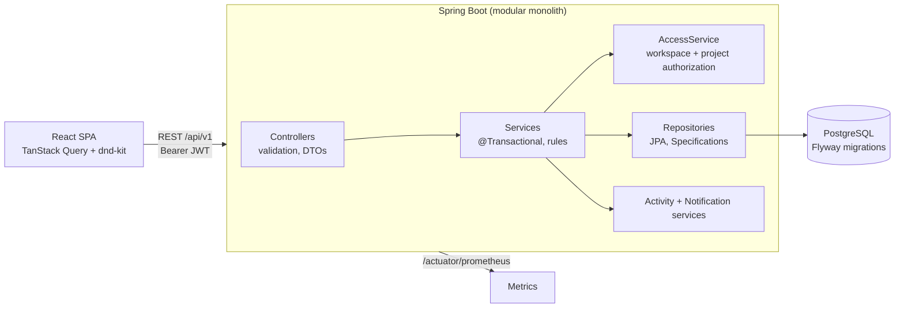
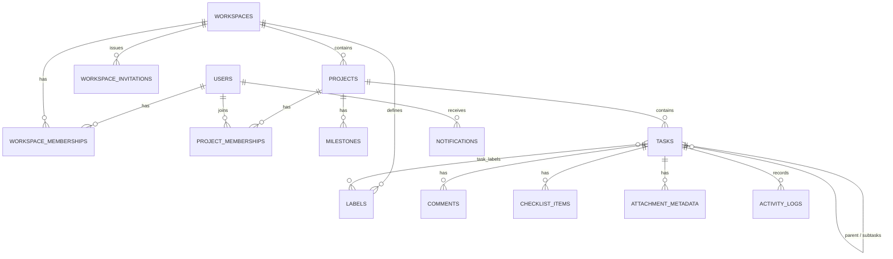

# Flowboard

A project management and team task board in the spirit of Linear / Trello: workspaces, projects, Kanban board with drag-and-drop, sortable list, timeline, task detail panel with comments and mentions, notifications, role-based permissions, light/dark mode.

**Stack:** Java 21 · Spring Boot 3.5 (Web, Security, Data JPA, Validation, Actuator/Micrometer) · PostgreSQL 16 + Flyway · React 19 + TypeScript · Tailwind CSS 4 · Radix UI primitives (shadcn/ui-style components) · TanStack Query · dnd-kit.

> The name and colors are easy to change: the product name lives in `frontend/index.html`, `Sidebar.tsx` (`Logo`) and the `--primary*` tokens in `frontend/src/index.css`.

## Run it

### Local development

Prerequisites: JDK 21+, Maven 3.9+, Node 22+, PostgreSQL 14+.

```bash
createdb flowboard && psql -c "create role flowboard login password 'flowboard' superuser"   # once
cd backend && SEED_DEMO=true mvn spring-boot:run        # API on :8080 (Flyway creates the schema)
cd frontend && npm install && npm run dev               # UI on :5173, proxies /api to :8080
```

Configuration is environment-variable based (see `.env.example` and `backend/src/main/resources/application.yml`): `DB_URL`, `DB_USER`, `DB_PASSWORD`, `JWT_SECRET`, `CORS_ALLOWED_ORIGINS`, `SEED_DEMO`.

## Deploy (Render)

`render.yaml` is a Blueprint: push the repo to GitHub, then Render > New > Blueprint. It creates a Postgres database, the API (built from `backend/Dockerfile`, because Render has no native Java runtime) and the static frontend, which proxies `/api/*` to the API so no CORS setup is needed. If you rename the API service, update the rewrite destination in `render.yaml`. Set `SEED_DEMO=false` for real use.

## Tests

| Layer | Command | What it covers |
|---|---|---|
| Backend unit + integration | `cd backend && mvn verify` | Spring Boot tests against a real PostgreSQL: `TEST_DATABASE_URL=jdbc:postgresql://localhost:5432/flowboard_test mvn verify` against any empty database. |
| Frontend | `cd frontend && npm test` | Vitest + Testing Library: API client, auth flow, table sorting/paging, confirm-before-delete, board grouping |
| End to end | `cd frontend && npx playwright test` | Real browser against the running stack: register, create project, create/drag/edit tasks, reload persistence, List view parity, filters, delete confirmation, cross-workspace URL access (`E2E_BASE_URL`, `E2E_CHROME=1` to use installed Chrome) |
| Load | see [`loadtest/README.md`](loadtest/README.md) | k6, 30,000 generated tasks |

Backend test highlights (`backend/src/test/java/com/flowboard/api`):
- `AuthorizationTest` - another workspace's ids always answer 404; member/manager/admin rules; invitations only for the invited email; archived projects are read-only.
- `TaskWorkflowTest` - sequential identifiers, column moves and reordering (including 40 repeated inserts that force re-spacing), stale version -> 409, DB-level filtering/sorting/paging, mentions -> notifications, activity history, idempotency key.
- `ConcurrencyTest` - 8 simultaneous edits with the same version: exactly one wins, seven get `409 CONCURRENT_MODIFICATION`; concurrent moves; 12 concurrent creates never duplicate `KEY-n`.


## Architecture

Modular monolith. HTTP concerns live in controllers, business rules and transactions in services, persistence in Spring Data repositories.



Packages (`com.flowboard`): `user` (auth, profile), `workspace` (memberships, invitations, roles), `project` (projects, members, milestones, favorites), `task` (tasks, labels, checklist, comments, attachments metadata, filtering, drag-and-drop ordering), `collab` (activity, notifications, dashboard, search), `security` (JWT, `AccessService`), `common` (errors, paging, logging), `seed` (demo + load-test data).

### Data model



All ids are UUIDs assigned by the application. Every table has foreign keys; uniqueness is enforced in the database (`email`, `(workspace, user)`, `(workspace, project_key)`, `(project, task_number)`, `(workspace, label name)`). Notable indexes: `tasks (project_id, status, position)` for the board, `tasks (assignee_id, status, due_date)` for My Tasks/dashboard, trigram GIN indexes on task title/description and project name for search, partial index for unread notifications, `(workspace, created_at desc)` for activity feeds.

### Security model

- Passwords: BCrypt. Auth: stateless HS256 JWT verified by Spring Security's OAuth2 resource server. **Logout is client-side** (token discarded); tokens simply expire (default 12 h). Storing the token in `localStorage` is a conscious simplicity trade-off (XSS would expose it); a production hardening step would be an httpOnly cookie + CSRF protection or short-lived tokens with refresh.
- Authorization is enforced in the **backend** by `AccessService` on every call, never only in the UI:
  - **Admin**: everything in the workspace, all projects, members, roles, invitations, settings.
  - **Manager**: create projects; edit/archive/delete projects and manage members for projects they belong to; manage labels.
  - **Member**: see projects they belong to; create/edit/move/comment on tasks there; delete only tasks they reported.
- Resources a caller cannot see answer **404, not 403**, so ids cannot be probed across workspaces. Role violations on visible resources answer 403.

### Concurrency and drag-and-drop

- `tasks.version` is a JPA `@Version`. Edits (`PUT /tasks/{id}`) and moves (`POST /tasks/{id}/move`) must send the version they read. A stale version -> `409 CONCURRENT_MODIFICATION`; a race that slips past the check is caught by Hibernate's `UPDATE ... WHERE version = ?` and mapped to the same response. The UI shows "Someone else changed this task..." and refetches; nothing is silently overwritten.
- Ordering uses fractional positions: dropping a card between neighbours A and B stores `(A+B)/2`; if the gap collapses below 1e-6 the column is re-spaced (a bulk update that deliberately does not bump versions). The client sends the neighbour (`afterTaskId`/`beforeTaskId`), never a raw number.
- Task numbers (`WEB-104`) come from one atomic `UPDATE projects SET task_seq = task_seq + 1 RETURNING` inside the creating transaction (a bug found by the concurrency test: reading the sequence through the entity lost updates).
- `POST /projects/{id}/tasks` honours an `Idempotency-Key` header; retries return the original task. Marking notifications read and moving a task to its current column are naturally idempotent.
- Activity rows are written in the same transaction as the change they describe (`Propagation.MANDATORY`).
- In the UI, edits to one task are queued and applied against the latest known version so quick successive edits by one person never conflict with themselves (found by the Playwright test).

### API

OpenAPI/Swagger UI at `/swagger-ui.html`, spec at `/v3/api-docs`. All routes live under `/api/v1`. Errors share one shape:

```json
{ "timestamp": "...", "status": 409, "code": "CONCURRENT_MODIFICATION", "message": "WEB-5 was changed by someone else...", "path": "/api/v1/tasks/..." }
```

Validation failures add `fieldErrors: { "email": "must be a well-formed email address" }`. Lists return `{ items, page, size, totalItems, totalPages }`. Task filtering (`status`, `priority`, `assigneeId`, `labelId`, `q`, `dueFrom`, `dueTo`, `overdue`), sorting and paging are translated into one SQL query via JPA Specifications; the board and the list view call the same endpoint.

Operational: structured JSON logs with a request id, Micrometer HTTP histograms (p50/p95/p99) on `/actuator/prometheus`, liveness/readiness probes.

## Demo flow

1. Start the app (see above), open <http://localhost:5173>, log in as `demo@flowboard.dev` / `Password123!` (Admin of "Acme Engineering").
2. **Overview**: metrics deep-link to filtered task lists; quick-create a task; see team activity.
3. **Projects -> Web App Redesign -> Board**: drag a card to another column or reorder inside one; reload - it persists. Filter by assignee/priority/labels/due date, sort, add a card with the `+` in a column header.
4. Click a card: edit priority/assignee/dates/labels, tick checklist items, add subtasks, comment with `@Marcus Rivera` (he gets a notification), view Activity.
5. **List** and **Timeline** show the same data. Add a milestone on the Timeline.
6. **Team**: invite someone (copy the link), change roles. Open the link in a private window, sign up, and observe the Member role limits (no "New project").
7. Open the same task in two browsers, edit in both: the second save reports the conflict instead of overwriting.

## Known limitations

- File attachments store **metadata only** (name, type, size); no binary storage.
- Invitations produce a shareable link; no email is sent. No password reset, email verification or rate limiting.
- Mentions are chosen from a picker and sent as ids; the comment body keeps plain `@Name` text.

Load-test method and measured results: [`docs/PERFORMANCE.md`](docs/PERFORMANCE.md).
